# BetterThanYesterday

**A free, all-in-one Android app for breaking bad habits, with live streak tracking, an AI coach, guided meditation and an emergency button for the hard moments.**

BetterThanYesterday was my final year project for my BSc in Computing Science (Stage 4, Software Development Project, June 2025). I designed, built, tested and documented the whole thing on my own, from the first wireframe to the final demo, over a single semester.

The idea behind the name is simple: you do not need to be perfect, you just need to be a little better than you were yesterday.

<p align="center">
  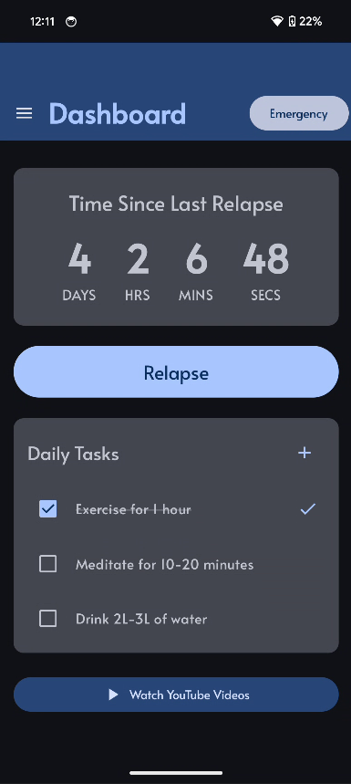
  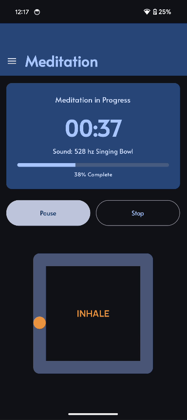
  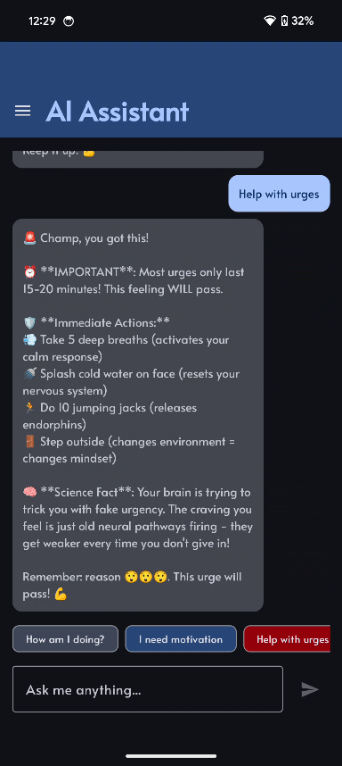
</p>

---

## Table of contents

- [Why I built it](#why-i-built-it)
- [What the app does](#what-the-app-does)
- [Screenshots](#screenshots)
- [Tech stack](#tech-stack)
- [Architecture](#architecture)
- [How the key parts work](#how-the-key-parts-work)
- [Data storage](#data-storage)
- [Project structure](#project-structure)
- [Getting started](#getting-started)
- [Testing and results](#testing-and-results)
- [Problems I hit and how I solved them](#problems-i-hit-and-how-i-solved-them)
- [How the project evolved](#how-the-project-evolved)
- [What I would add next](#what-i-would-add-next)
- [Research behind the app](#research-behind-the-app)

---

## Why I built it

Most well reviewed habit apps (Habitica, Streaks, Forest and others) lock their best features behind a subscription, fill the free version with ads, or only cover one small piece of the problem. None of them looked at the link between mental health and relapse, which is often the real reason people fall back into a habit.

So I set out to build one app that combines the best parts of all of them, adds the mental health support they leave out, and gives every feature away for free with no ads.

The app is aimed at people trying to quit things like smoking, alcohol, substance use or any habit that causes guilt and stress. When someone is anxious or alone, a tool that remembers their progress, talks to them and gets them through a craving can make the difference.

| Feature | Habitica | Streaks | Forest | **BetterThanYesterday** |
|---|---|---|---|---|
| Free access | Limited | Basic only | Limited | **Full** |
| Mental health support | No | No | No | **Yes** |
| Emergency tools | No | No | No | **Yes** |
| Meditation timer | No | No | No | **Yes** |
| Custom tasks | Premium | No | No | **Yes** |
| Progress analytics | Premium | No | No | **Yes** |
| Works offline | Partial | Yes | Partial | **Yes** (all except the AI chat) |

---

## What the app does

### Live streak counter
The heart of the app. A stopwatch style counter on the dashboard shows exactly how long you have gone without the habit, in days, hours, minutes and seconds, ticking every second. Press **Relapse** and it resets, while your longest ever streak is kept in your stats. It is timestamp based, so it stays accurate across app restarts, backgrounding and phone sleep (tested over 48 hour runs).

### Daily tasks
Four healthy default tasks to start you off (exercise for an hour, meditate 10 to 20 minutes, drink 2 to 3 litres of water, journal) plus your own custom tasks, like "go for a walk when an urge hits". Tick them off, rename or delete them, and the app tracks your daily completion rate.

### AI habit coach (Google Gemini)
A 24/7 chatbot that knows your name, the habit you are quitting, your reason for quitting and your current streak, and uses all of that in its replies. It remembers the last few messages so conversations flow naturally. Quick action buttons ("How am I doing?", "I need motivation", "Help with urges", "My current streak", "Give me tips", "Brain science facts") give instant help without having to type during a stressful moment. Common requests are answered locally and instantly, and anything more open is sent to Gemini. If the network or the API is down, it falls back to pre-written support so the user is never left with nothing.

### Emergency button
Always visible in the top bar on every screen. One tap shows a random motivational quote from a set of 18+ (for example "You didn't come all this way for nothing"). It is designed to break the automatic habit loop by making you pause and rethink, and every press is logged so you can spot patterns in your hardest moments.

### Guided meditation
- Timer from 1 to 60 minutes with a wheel picker, plus pause, resume and stop
- 8 sound options: silent, white noise, brown noise, pink noise, 528 Hz singing bowl, Wim Hof breathing, handpan music, ocean waves and rainfall
- A Lottie box breathing animation (4 seconds in, hold, out, hold) so beginners can follow along
- A progress bar and a "Well done" message at the end
- Audio keeps playing when the app is minimised, with careful MediaPlayer cleanup to avoid memory leaks

### Statistics
Expandable cards that open up into interactive Vico charts: relapses, emergency button use, app opens, task completion rate, a 7 day completion trend, your last relapse and your highest streak.

### Motivational videos
A curated set of self improvement YouTube videos with thumbnails, opened from a popup dialog on the dashboard.

### Notifications
Personalised reminders when you leave the app, such as "Stay strong Champ! You got this!", with a random message each time so they do not get stale. Notification permission is requested properly on Android 13+ and the app keeps working if it is denied.

### Onboarding, login and settings
- Onboarding flow that asks for your name, the habit you want to break and why
- Local register and login, with passwords stored as SHA-256 hashes rather than plain text
- Settings to update your profile (changes show up everywhere, including the chatbot) and a "Restart your journey" reset with a confirmation step
- Light and dark themes with medium and high contrast variants for accessibility

---

## Screenshots

### Dashboard and navigation
| Navigation drawer | Dashboard | Motivational videos |
|---|---|---|
| 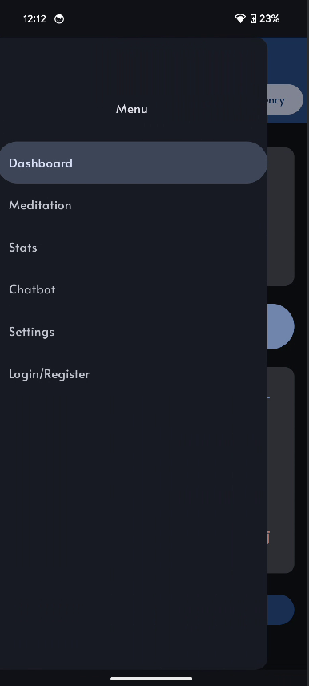 |  | 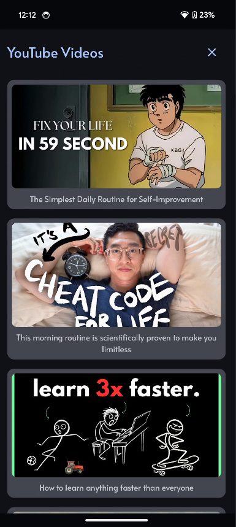 |

### Meditation
| Choose a sound and duration | Session in progress |
|---|---|
| 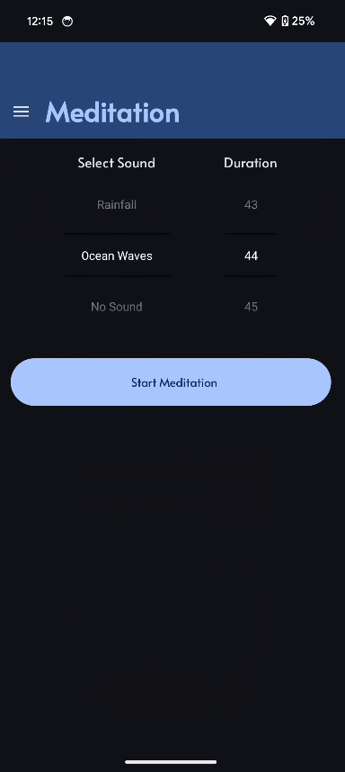 |  |

### Statistics
| Summary cards | Expanded chart |
|---|---|
| 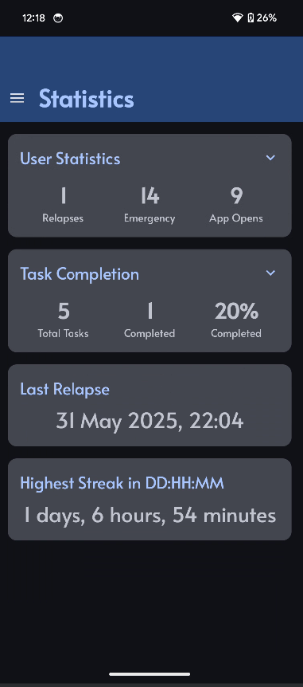 | 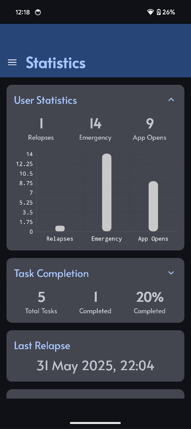 |

### AI coach
| Personalised welcome | "How am I doing?" | "Help with urges" |
|---|---|---|
| 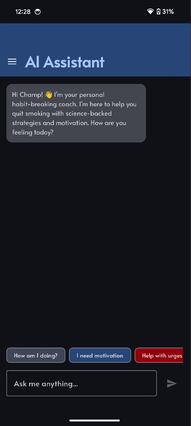 | 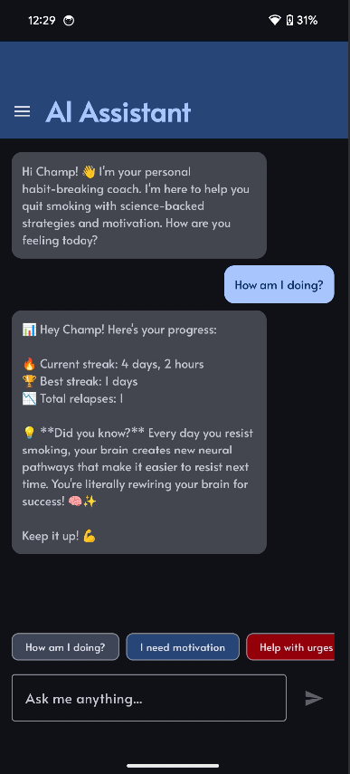 |  |

### Early wireframes
I planned the interface in Excalidraw before writing any code. The first version (week 2) covered onboarding, the home page, tasks and videos:

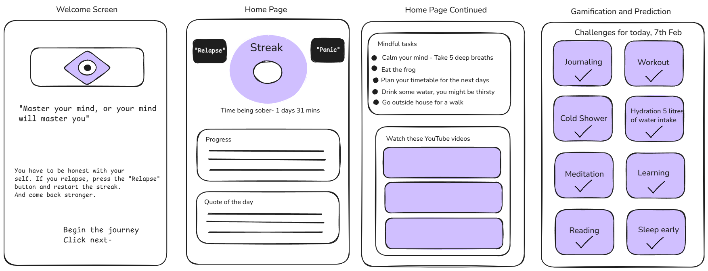

By week 4 the full design was mapped out, including settings, stats, the chatbot and login:

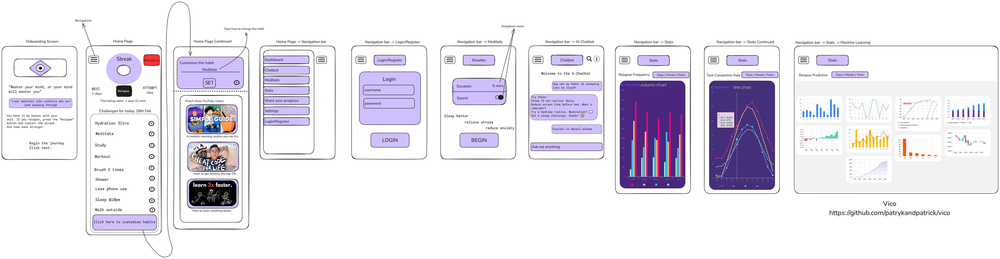

Comparing these with the screenshots above shows how much of the original plan made it into the finished app.

---

## Tech stack

| Area | Technology |
|---|---|
| Language | Kotlin 1.9.0 |
| UI | Jetpack Compose (BOM 2024.04.01) with Material Design 3 |
| Architecture | Model View Controller (MVC) |
| AI | Google Gemini 1.5 Pro through the Google Generative AI SDK 0.9.0 |
| Charts | Vico (Compose and Material 3 modules) |
| Animation | Lottie for Compose, Coil (with GIF support) for images |
| Navigation | Navigation Compose with a Material 3 navigation drawer |
| Async | Kotlin Coroutines and StateFlow |
| Storage | Android SharedPreferences (on device only) |
| Audio | Android MediaPlayer with lifecycle aware cleanup |
| Fonts and theme | Google Fonts "Alata", colours from Material Theme Builder |
| Build | Gradle 8.7 with Kotlin DSL and a version catalog, AGP 8.6.1 |
| IDE | Android Studio Koala Feature Drop (2024.1.2) |
| Design | Excalidraw for wireframes, draw.io for diagrams |
| Version control | Git and GitHub |

**Platform targets:** minimum SDK 24 (Android 7.0), target and compile SDK 35.

### Why these choices
- **Android first:** around 70% of phones worldwide run Android, so it reaches the most people, including those who cannot afford an iPhone.
- **Native Kotlin over Flutter or React Native:** direct access to Android APIs, better notification and background audio handling, and stronger security integration, which matters for a mental health app.
- **Jetpack Compose over XML:** a declarative UI where each screen is a function of its state. Less boilerplate, more reuse, cleaner code.
- **Gemini over other AI APIs:** a generous free tier keeps the app free for users, and the official Android SDK makes integration straightforward.
- **Vico over AAChartModel, Rings and AnyChart:** I compared all four. Vico is built for Compose, actively maintained and looks the most modern.
- **SharedPreferences over Room:** I spent around two weeks on Room before deciding the data was simple key value data. Switching cut out a lot of complexity and kept everything private on the device.

---

## Architecture

The app follows **Model View Controller**, keeping data, UI and logic cleanly separated so each part can be built and tested on its own.

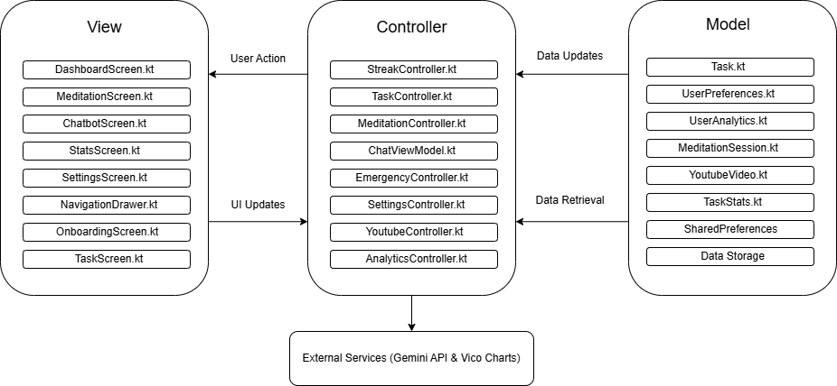

```
User action  ->  View (Compose screen)  ->  Controller  ->  Model  ->  SharedPreferences
                        ^                                                   |
                        +--------------- state update (StateFlow) ----------+
```

- **Model** holds the data classes and core logic: `Task`, `TaskStats`, `User`, `UserAnalytics`, `UserPreferences`, `MeditationSession`, `YoutubeVideo`
- **View** is made up of composable screens: Dashboard, Tasks, Meditation, Statistics, Chatbot, Settings, Login, Onboarding and the navigation drawer, plus the `ChatViewModel` and `StatsViewModel`
- **Controller** handles the logic between the two: `StreakController`, `TaskController`, `MeditationController`, `EmergencyController`, `AnalyticsController`, `SettingsController`, `AuthController`, `YouTubeController` and `NotificationHelper`

For example, when you tick a task the screen tells `TaskController`, which updates the model, saves it, recalculates the stats and pushes new state back to the UI, all within milliseconds.

---

## How the key parts work

### Real-time streak counter
`StreakController` stores the start time of the current streak and works out the elapsed days, hours, minutes and seconds from the real clock, so nothing drifts when the app is closed.

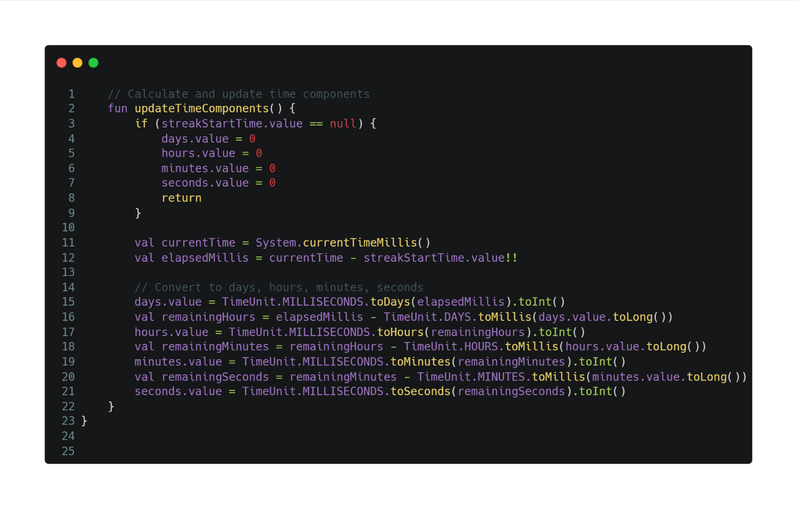

The dashboard runs a coroutine that refreshes it every second while the screen is visible:

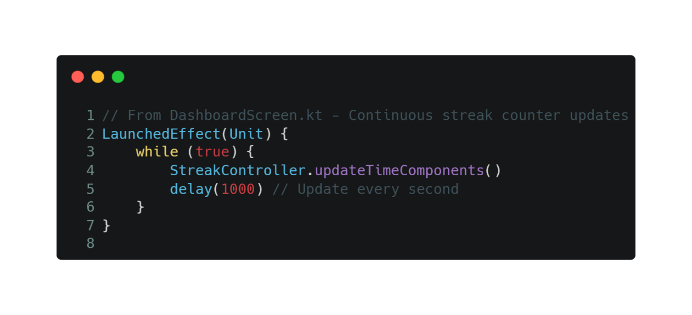

### AI coach prompt flow
```
User message -> quick command check (instant local reply)
             -> otherwise: build a personalised prompt -> Gemini -> reply on screen
             -> on error: friendly fallback message
```
Each prompt includes the user's name, habit, reason for quitting, current streak and the last six messages of the conversation, along with coaching rules such as "remind them urges last 15 to 20 minutes" and "include real neuroscience about habit change".

### Emergency support
A random quote is shown and the press is recorded in the analytics so it appears in the stats.

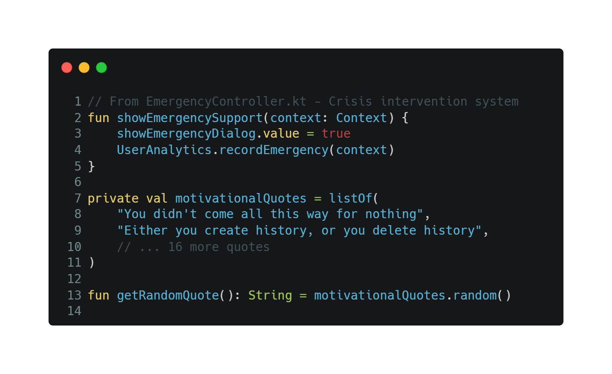

### Notifications
Permission is checked first, then a random personalised message is sent.

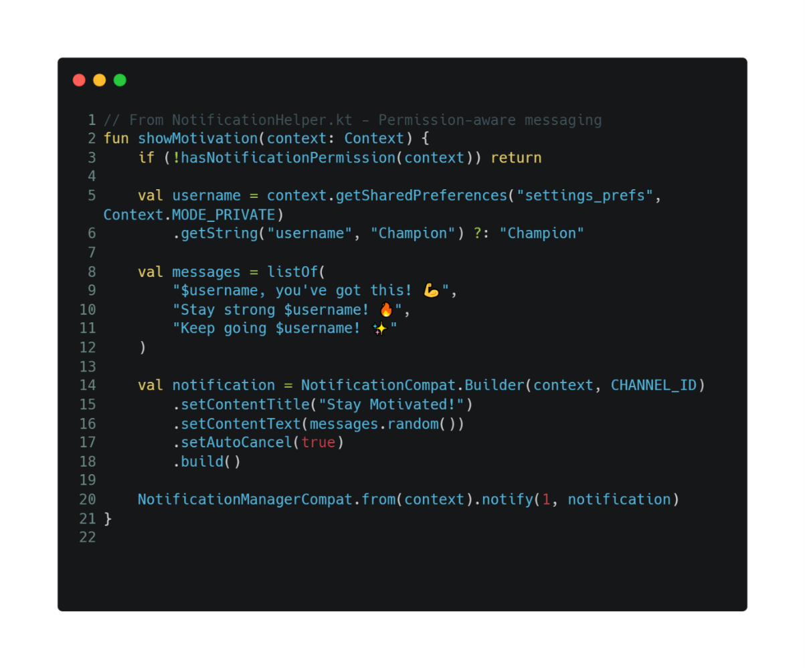

### Video thumbnails
Each video title is mapped to a bundled thumbnail, with a safe fallback image if a new video is added without one.

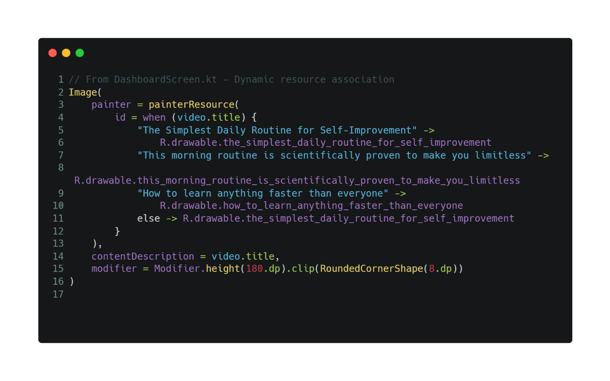

---

## Data storage

Everything is stored locally on the phone in separate SharedPreferences files. Nothing is sent to a server apart from chat messages going to Gemini.

| File | What it holds |
|---|---|
| `user_prefs` | Name, habit being broken, reason for quitting, login details (password hashed) |
| `streak_prefs` | Streak start time and longest streak |
| `task_prefs` | Default and custom tasks, completion status, daily progress |
| `analytics_prefs` | Relapse count, emergency button presses, app opens |
| `settings_prefs` | Notification and theme preferences |
| Meditation data | Preferred sound and session length |

Splitting data by type keeps reads fast and lowers the risk of one bad write corrupting everything. `StatsViewModel` pulls from all of them and shapes the data for the Vico charts.

---

## Project structure

```
app/src/main/java/com/griffith/habittracker/
├── MainActivity.kt              App entry point, permissions, navigation host
├── Controller/
│   ├── AnalyticsController.kt   Usage tracking
│   ├── AuthController.kt        Register and login with SHA-256 password hashing
│   ├── EmergencyController.kt   Emergency quotes and logging
│   ├── MeditationController.kt  MediaPlayer, sounds, sessions
│   ├── NotificationHelper.kt    Personalised notifications
│   ├── SettingsController.kt    Profile and reset
│   ├── StreakController.kt      Live streak maths
│   ├── TaskController.kt        Task logic and completion rates
│   └── YouTubeController.kt     Video list and opening links
├── Model/                       Data classes (Task, User, UserAnalytics, ...)
├── View/                        Compose screens and ViewModels
└── ui/theme/                    Colours, typography (Alata), light and dark themes
app/src/main/res/
├── drawable/                    Video thumbnails and launcher icon
└── raw/                         Lottie breathing animation and GIF
docs/images/                     Screenshots, diagrams and wireframes used in this README
```

---

## Getting started

1. Clone the repo and open it in Android Studio (Koala or newer).
2. Get a free Gemini API key from [Google AI Studio](https://aistudio.google.com/).
3. Add it to `local.properties` in the project root (this file is git ignored, so your key stays private):
   ```
   GEMINI_API_KEY=your_key_here
   ```
4. **Meditation audio:** the sound files are not included in this repo because of their size and licensing. To use the meditation sounds, add your own MP3s to `app/src/main/res/raw/` with these names: `white_noise`, `brown_noise`, `pink_noise`, `hz_528_singing_bowl`, `guided_wim_hof_method_breathing`, `handpan_music_by_malte_marten`, `ocean_waves`, `rain_sounds`.
5. Sync Gradle and run on an emulator or a phone with Android 7.0 or newer.

Everything except the AI coach works offline.

---

## Testing and results

I tested the app manually across functionality, UI, integration between the MVC layers, performance and device compatibility.

**Devices**
- Google Pixel 8 (Android 14), main test device: every feature worked smoothly
- Samsung Galaxy M31s (Android 11), compatibility testing: everything worked, and a dialog rendering bug I found there was fixed

**Performance**
- Streak counter stayed accurate over 48 hour tests, through sleep and wake cycles
- No audio memory leaks during long meditation sessions
- Gemini replies averaged 2 to 3 seconds, and the fallback replies kicked in correctly when the API was unavailable
- SharedPreferences reads and writes never blocked the UI

**User testing**
Three testers aged 22 to 75, with different levels of tech experience and different habits:
- The live streak counter and the personalised AI replies were the favourites
- Every tester liked the breathing animation and the variety of sounds
- Default tasks felt relevant and custom tasks were easy to add
- The emergency button was especially valued by testers who are less comfortable with AI, since a simple quote was often all they needed

---

## Problems I hit and how I solved them

| Problem | What I did | Result |
|---|---|---|
| Large meditation MP3s caused "not enough space" install failures | Compressed and shortened the audio and tightened MediaPlayer cleanup | App size cut by about 60% with no noticeable loss in quality |
| YouTube section would not render because of nested scroll containers | Rebuilt the dashboard around a single `LazyColumn` | Section displays reliably |
| YouTube dialog broke on Android 11 (Samsung M31s) | Used alternative dialog properties for older Android versions | Consistent on all tested devices |
| Streak timer drifted when the app was in the background | Switched to timestamp based maths checked against system time | Accurate across sleep and wake |
| Gemini rate limits during testing | Added request delays, graceful fallbacks and a local quick reply layer | Users always get a response |
| Gemini setup errors in Logcat | Debugged the `GenerativeModel` config and wrapped network calls in try/catch | Stable AI replies |
| Keeping charts in sync across several preference files | Built `StatsViewModel` as one aggregator with state triggers | Charts update live without a manual refresh |
| Two weeks lost on Room database complexity | Moved to SharedPreferences, which suited the data better | Simpler code and faster development |

---

## How the project evolved

The project followed an iterative, incremental approach across five phases, with weekly supervisor meetings guiding each step.

1. **Planning and architecture (weeks 1 to 4):** settled the concept, expanded the scope after supervisor feedback, compared chart libraries, drew the wireframes and set up the MVC structure. Started onboarding and the streak counter.
2. **Core features (weeks 5 to 7):** researched timers, notifications and chatbot APIs, built the dashboard and relapse tracking, and solved the audio storage problem.
3. **Integration and refactoring (weeks 8 to 9):** moved logic into dedicated controllers, added YouTube integration, finished onboarding with saved user data, and got Gemini working.
4. **Statistics and polish (week 10):** added Vico charts, popup dialogs, full analytics tracking, the finished chatbot UI and a better settings screen.
5. **Testing and finishing (final weeks):** cross device testing, compatibility fixes and fine tuning the chatbot commands, ending in a live final demo.

The original plan also included a React website with a Python backend, PostgreSQL, social leaderboards and machine learning relapse prediction. I made a deliberate call in week 6 to focus on one polished, complete mobile app instead of several half finished pieces, and I think the final product is much stronger for it.

---

## What I would add next

- An iOS version in SwiftUI
- Secure cloud sync and backup with end-to-end encryption
- Uploading your own meditation audio or linking a music service
- Smart notifications timed around each user's patterns
- Smartwatch support, linked with step and calorie apps
- Machine learning to predict relapse risk and step in at the right moment
- Community features and smarter video recommendations

---

## Research behind the app

The features are grounded in published research I reviewed for the project:

- **Self-control works like a muscle** and gets stronger with practice, which shaped the streak and daily task design (Bruton, 2024).
- **Habits form through consistent behaviour in the same context**, not just repetition (Gardner et al., 2022).
- A study of **280,000 meditation sessions in 103 countries** found that mood, calm and resilience improve with app based meditation, and that consistency matters more than session length (Cearns et al., 2023).
- People who meditate at similar times each day are **73% more likely to still be meditating six months later** (Stecher et al., 2021).
- **Conversational AI can deliver real mental health support**, with the big advantage of being available instantly at any hour (Fitzpatrick et al., 2017).

---

## About this project

Built as my BSc Computing Science final year project (Software Development Project, Stage 4), submitted June 2025. The full submission included this app, a detailed written report covering research, design, implementation and testing, a presentation, and a live demo, all supervised through weekly meetings across the semester.
